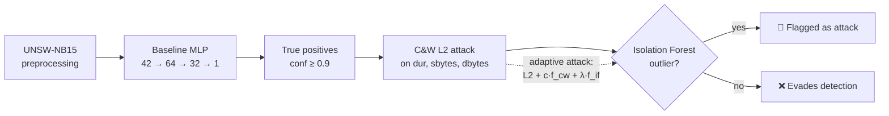

# 🛡️ Adversarially Robust Intrusion Detection

> How easily can an attacker fool a deep-learning IDS by slightly modifying network traffic, and can we detect it? A study of the **Carlini & Wagner (C&W) attack** and an **Isolation Forest defence** on UNSW-NB15.

**Author:** Mohamed EL HARCHALI

---

## 📌 Table of Contents

- [Context](#-context)
- [Threat model](#-threat-model)
- [Pipeline](#%EF%B8%8F-pipeline)
- [Results](#-results)
- [Repository structure](#-repository-structure)
- [Getting started](#-getting-started)
- [Limitations & next steps](#%EF%B8%8F-limitations--next-steps)

---

## 🎯 Context

Machine-learning IDSs reach high detection rates on benchmark datasets, but they are vulnerable to **adversarial examples**: small, targeted changes to an input that flip the model's decision. For an IDS, this means an attack disguised as normal traffic, which is a **false negative**.

This project:

1. trains a baseline MLP IDS (binary: normal vs attack);
2. attacks it with **C&W L2**, perturbing only a few features an attacker can realistically control;
3. defends it with an **Isolation Forest** that flags out-of-distribution inputs;
4. tests an **adaptive attacker** that tries to evade both the IDS and the defence.

---

## 🎭 Threat model

| Aspect | Choice |
|---|---|
| Attacker goal | Turn detected attacks (true positives) into **false negatives** with confidence ≥ 0.9 |
| Attacker knowledge | **White-box**: full access to the model's gradients |
| Manipulable features | Only `dur`, `sbytes`, `dbytes` (duration and volume of traffic), plus a variant using `sinpkt` |
| Targeted samples | Attacks correctly detected with P(attack) ≥ 0.9 |
| Defender | Isolation Forest trained on the distribution of normal traffic for the manipulable features |

Restricting the perturbation to traffic-level features keeps the attack closer to what is achievable in practice (padding packets, delaying traffic), rather than arbitrary changes to every feature.

---

## ⚙️ Pipeline



- **Seeds** fixed to 42 for reproducibility
- **Model:** MLP `42 → 64 → 32 → 1`, `BCEWithLogitsLoss`, 10 epochs, trained on GPU
- **C&W L2:** Adam-optimised perturbation, up to 1,500 steps, restarts with noise, cosine-annealing learning rate
- **Adaptive attack:** adds an Isolation-Forest penalty `λ · max(0, threshold − score_IF(x'))` through a differentiable surrogate, so that adversarial examples stay "normal-looking"

---

## 📊 Results

### Baseline IDS (test set, 82,332 flows)

| Accuracy | Precision | Recall | F1-score |
|---|---|---|---|
| 0.852 | 0.800 | 0.977 | 0.879 |

### C&W attack, without defence

| Setting | Attack success (TP → FN, conf ≥ 0.9) |
|---|---|
| Test set, perturbing `dur`, `sbytes`, `sinpkt` | **99.98%** (39,629 / 39,636) |
| Test set, perturbing `dur`, `sbytes`, `dbytes` | **98.39%** (38,998 / 39,636) |

➡️ The baseline IDS is almost completely bypassed by a white-box attacker changing only three traffic features.

### Isolation Forest defence

| Metric | Value |
|---|---|
| False negative rate, MLP alone | 99.68% |
| False negative rate, MLP + Isolation Forest | **0.00%** |
| False positive rate on normal traffic | 15.93% |
| AUC (normal vs adversarial) | 0.9975 |
| Adversarial examples bypassing the IF (test set) | 8.4% – 20.8% depending on the attack variant |

**Takeaways**

- ✅ C&W adversarial examples are **statistically abnormal**: the Isolation Forest separates them from normal traffic almost perfectly (AUC ≈ 1).
- ⚠️ The defence has a cost: about **16% false positives** on legitimate traffic.
- 🔬 An **adaptive attacker** that knows about the Isolation Forest can push examples back inside the normal distribution. The λ trade-off between fooling the MLP and staying undetected is explored in the notebook.

---

## 📁 Repository structure

```
.
├── C&W_Attack.ipynb   # Baseline, C&W attacks, Isolation Forest defence, adaptive attack
├── requirements.txt
└── README.md
```

---

## 🚀 Getting started

1. Download `UNSW_NB15_training-set.csv` and `UNSW_NB15_testing-set.csv` from the [official UNSW-NB15 page](https://research.unsw.edu.au/projects/unsw-nb15-dataset) and place them next to the notebook (or upload them to Colab).
2. Install the dependencies:

   ```bash
   pip install -r requirements.txt
   ```

3. Run the cells in order. A GPU is recommended (the attack optimises tens of thousands of examples).

---

## ⚠️ Limitations & next steps

- The notebook gathers successive experiments; the final structured "Project 1" pipeline cell is still in progress.
- Perturbed features are not yet projected back onto realistic constraints (integer byte counts, protocol consistency).
- [ ] Adversarial training and ensemble defences
- [ ] PR-AUC / ROC-AUC reporting for every setting
- [ ] Black-box and transfer attacks
- [ ] Reduce the Isolation Forest false-positive rate (per-feature thresholds, contamination tuning)

---

## 📚 References

- Carlini & Wagner, *Towards Evaluating the Robustness of Neural Networks*, IEEE S&P 2017
- Liu, Ting & Zhou, *Isolation Forest*, ICDM 2008
- Moustafa & Slay, *UNSW-NB15: a comprehensive data set for network intrusion detection systems*, MilCIS 2015
